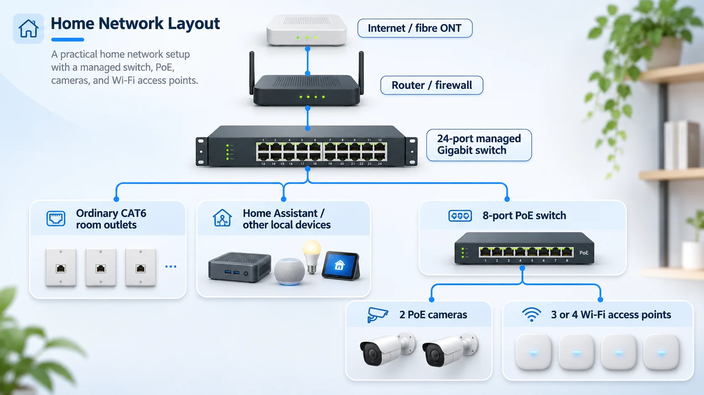

# Planning My Home Network in the Philippines: 24 or 48 Ports, PoE and Rack Options

I started looking for a network cabinet for our house in Liloan, Cebu. I was expecting a fairly simple decision: choose a 19-inch rack, put a 48-port switch inside, and leave enough space for the router and the rest of the equipment.

Then my architect asked where we were actually going to put it.

That question made me review the whole plan. The house is still under construction, so I can change cable routes and equipment locations before the ceilings and walls are finished. I would rather solve this now than end up with an oversized cabinet in a bad location.

I am still comparing a **48-port switch, a compact 24-port switch, and arrangements with multiple smaller switches**. The cabinet might be conventional, vertical, or partly custom-built. I have not settled where it will go. Nothing has been installed yet, and I want to understand the trade-offs before choosing.

## The Service Room Was Already Getting Crowded

The original candidate was a service/storage room measuring about **3.75 × 1.35 metres**, or **5.06 m²**. On paper that sounds reasonable. In practice, it is a narrow room that was being asked to accommodate quite a lot:

- Domestic water storage, pump and pressure tank
- Water softener
- Electrical distribution equipment
- Solar inverter and associated equipment
- Possibly the network cabinet

My concern was the combination. Water systems need maintenance, and I do not want network equipment beside plumbing, possible leaks or condensation. The electrical and solar equipment also need their own working clearances and ventilation.

Our contractor, Ruaya, suggested moving some water equipment to the side of the house. One option is to put the domestic freshwater tank underground, beside the house rather than beneath the building. We are also investigating underground placement for the required **2,000-litre rainwater tank**, kept separate from domestic water. The rainwater is intended for irrigation and other permitted non-potable uses. The pumps, pressure tank and water softener would still need an accessible, protected service area.

None of this is approved yet. Underground tanks beside the house need engineering checks for excavation near the foundations, groundwater uplift, waterproofing, contamination prevention, drainage and maintenance access. Moving a problem outside does not automatically make it safe.

If that arrangement works, the existing service room might have more room for electrical and solar systems, subject to their required separation and working clearances. I could place the network cabinet there if the conditions are suitable, or in a **separate dry location**, potentially around the foyer or stairs. The architect and relevant engineers still need to review both possibilities.

## My First Idea Was a 48-Port Switch

I originally looked at a full-size managed Gigabit switch. A 48-port model sounded sensible for a house with four bedrooms, an office, cameras, several Wi-Fi access points and Home Assistant.

One candidate was the **[TP-Link Omada SG3452](https://www.tp-link.com/us/business-networking/omada-switch-access/sg3452/)**. TP-Link lists **48 Gigabit Ethernet ports, four SFP slots, fanless cooling and a 440 × 220 × 44 mm chassis**. It is a proper rack-width switch, although it does not supply PoE to cameras or access points.

I also investigated the **[Zyxel GS1900-48](https://store.zyxel.com/gs1900-48-eu0102f.html)**. An overseas Amazon listing I noted translates to approximately **₱26,900 for the switch plus ₱1,700 delivery**, or **₱28,600 total**, at the [3 November 2026 exchange rate of about ₱17.31 per dirham](https://www.investing.com/currencies/aed-php-historical-data). This is only a currency conversion of that listing, **not a Philippine supplier quote or a price I have paid**. The marketplace dimensions looked suspiciously small. [Zyxel's rack-mount guide](https://mysupport.zyxel.com/hc/en-us/articles/34308391717778-Zyxel-Rack-Mount-Guide-19-Installation-Support-for-Switches-and-H-Series-Firewalls) instead lists **440 × 200 × 44 mm**. Zyxel describes this model as using a smart fan, so noise was another consideration.

The problem was not only the purchase price. With a cabinet I wanted to keep as shallow as possible, a **20–22 cm-deep switch leaves very little space** for the Ethernet plugs, power cable and cable bends. I also would still need something to power the PoE devices.

Before deciding on the cabinet, I went back to the house plan and counted the connections.

## Counting the CAT6 Runs Changed My Assumptions

These are the current allowances, not an as-built cable schedule:

| Location | Planned CAT6 connections |
|---|---:|
| Four bedrooms, one each | 4 |
| Office / flex room | 4 |
| TV / safe room | 1 |
| Main living room | 2 |
| Kitchen / dining | 1 |
| Garage / service area | 1 |
| Covered patio / garden | 1 |
| Roof deck / attic | 2 |
| PoE security cameras | 2 |
| Wi-Fi access points | 4 |
| **Total** | **22** |

The office gets four connections because I expect more wired equipment there. The bedrooms get one each. We are allowing for four Wi-Fi access points, but the final number and locations need a proper coverage plan. Two wired PoE cameras are planned for now; other battery or cellular cameras do not necessarily need a CAT6 run.

**Twenty-two cable runs is not the same thing as needing 22 live switch ports from day one.**

Each cable can terminate in a passive CAT6 patch panel. The patch panel is simply the place where the fixed house cabling ends. A short patch lead connects a selected outlet to the switch. If a bedroom outlet is not needed, its cable can stay terminated but disconnected.

I am considering **28–32 termination positions** in total so we can add some cable runs later. That does not mean buying a 32-port switch today. In fact, because extra cable is easier to install while a house is open, I would rather decide the spare cable locations now, not after plastering.

That count made me look at smaller switches more seriously, without excluding a 48-port model if it turns out to be easier to accommodate or better for future expansion.

## Comparing One Big Switch with Several Smaller Ones

I do not have a final switch configuration. The 48-port idea is still on the table, especially if we decide to activate more outlets in the future. A 24-port switch would be smaller, but combining smaller switches can also complicate the cabling and maintenance.

PoE means **Power over Ethernet**. It lets compatible cameras and Wi-Fi access points receive power over their network cable. At present I am allowing for **two PoE cameras and four Wi-Fi access points**, though the Wi-Fi count may decrease after checking coverage. That is up to **six powered connections**, assuming all four access points use PoE.

These are the arrangements I am comparing:

| Arrangement | Advantages for this house | Disadvantages or questions |
|---|---|---|
| One 48-port managed switch, with PoE supplied separately if necessary | Plenty of spare ports; straightforward central management; easier to activate extra wall outlets | Larger chassis and cabinet clearance; many ports may sit unused; a non-PoE model still needs injectors or a PoE switch |
| One 24-port managed switch plus an 8-port PoE switch | Can use a shallow, fanless main switch; buy PoE capacity only where needed; replace or expand the powered switch independently | Two power connections, an inter-switch uplink, extra cables and configuration; PoE port and wattage limits need checking |
| Two 16-port switches, with suitable PoE capacity | Potentially flexible placement and a wider choice of compact units; expansion can happen in smaller steps | Each extra switch needs power and management; uplink ports reduce usable capacity; traffic between switches shares the uplink |
| One 24-port managed PoE switch | Fewer devices, one central switch and no separate inter-switch link | May cost more and produce more heat or fan noise; 24 ports could become tight when router, outlets and future devices are included |
| One larger managed PoE switch | Simpler cabling if one unit can power everything; more room for expansion | Larger PoE power supply and enclosure requirements; cost, noise and idle power depend on the specific model |

There is no winner yet. A single larger switch has the advantage of simplicity. Multiple smaller ones can be more compact and make selective upgrades easier, but they mean more devices to power and troubleshoot. I would also need to check that managed switches work together with the VLANs I want.

**One possible arrangement** is a 24-port non-PoE switch connected to an 8-port PoE switch:

*This is an illustration of one option, not the selected equipment or final installation. Some smart-home devices shown may connect wirelessly through Home Assistant rather than directly by Ethernet.*

With the present **22 CAT6 runs**, six are allowed for the two cameras and four access points. That leaves **16 ordinary wired outlets**. In the two-switch arrangement, the 24-port switch would serve those outlets, the router, the PoE-switch uplink and any central devices such as Home Assistant. Some outlets can remain disconnected at the patch panel until needed.

The 8-port PoE switch is close to full if six devices use PoE and another Ethernet port is needed for its uplink. On a model with eight shared ports and no dedicated uplink, that is **seven of eight ports used**. More cameras or access points might push me towards 16 PoE ports or a different switch combination.

Port count is only half the PoE question. I also need the actual power consumption of the camera and access-point models, their PoE standards and the switch's total power budget. I cannot confirm an 8-port model until those are selected.

An ordinary Gigabit uplink between switches should be reasonable for the initial household traffic, but it can become a shared bottleneck if I add heavy local recording, network storage or faster devices. A switch with faster uplink ports may be worth comparing. I also need to account for whether the switch supports VLANs properly.

All the house CAT6 cables would still terminate at passive patch panels. Whether I buy one switch or several, I want the permanent cabling to be flexible. Buying spare cable runs now is different from powering dozens of empty switch ports every day.

## The Compact Switches I Started Comparing

As another option alongside the 48-port models, I found several much shallower 24-port switches.

| Switch | Chassis (W × D × H) | What interests me |
|---|---|---|
| [TP-Link Omada ES224G](https://www.tp-link.com/uk/business-networking/omada-switch-agile/es224g/) | 294 × 140 × 44 mm | 24 ports, easy-managed features, fanless |
| [Zyxel GS1900-24E](https://www.zyxel.com/global/en/products/switch/gs1900-series) | 267 × 162 × 42 mm | 24 ports, smart managed, fanless |
| [TP-Link TL-SG1024DE](https://www.tp-link.com/ae/business-networking/soho-switch-easy-smart/tl-sg1024de/) | 294 × 180 × 44 mm on the linked regional specification | 24 ports, Easy Smart, fanless |
| [Zyxel GS1100-24ES](https://mysupport.zyxel.com/hc/en-us/articles/34308391717778-Zyxel-Rack-Mount-Guide-19-Installation-Support-for-Switches-and-H-Series-Firewalls) | 280 × 126 × 44 mm | Very shallow, but unmanaged |

These are manufacturer-published dimensions for the versions and pages linked above, **not a guarantee for every hardware revision**. For example, TP-Link also publishes a [TL-SG1024DE V7 datasheet](https://static.tp-link.com/upload/product-overview/2026/202605/20260526/TL-SG1024DE%28UN%297.0_datasheet.pdf) showing a **140 mm** chassis depth. That is a good reason to check the exact revision before ordering, especially when a few centimetres make a difference.

I prefer a fanless switch if the cabinet ends up near occupied rooms. I also want some management features, rather than buying the shallowest unmanaged switch just to save space.

With **Home Assistant**, smart-home devices, guests and cameras, I would like to separate parts of the network using **VLANs**. A VLAN is a way to keep groups of devices on different logical networks even when they share physical switches. The switches, access points and router/firewall all need to support the intended setup. VLANs alone are not a firewall; the router rules still control which networks can talk to each other.

The ES224G and GS1900-24E are interesting compact candidates, but I am still comparing them with bigger switches and multi-switch layouts. Their management features are not identical, so I need to check the exact VLAN and uplink behaviour rather than assume every switch advertised as "managed" works the same way.

## Is a 25 cm-Deep Cabinet Actually Possible?

My target is a cabinet that projects only about **25 cm from the wall**. Width and height are less of a problem.

The tempting calculation is **250 mm cabinet depth minus 140 mm switch depth = 110 mm left**. But that is only an illustration. A switch chassis dimension is not the same as the usable depth inside the cabinet, and the cabinet's external depth includes its doors, panels and mounting structure.

I still need space for Ethernet plugs at the front, cable bends, the power connection, ventilation, brackets and access when something needs replacing. A patch panel in front of the switch can also change how cables must be routed.

A cabinet advertised as 250 mm deep may have considerably less usable internal space. I will need to draw the actual hardware to scale, including the patch leads, before deciding whether **25 cm** works. A **30 cm** option would be easier, but it would also project further into the room.

Another idea is to mount the network equipment vertically rather than in the normal horizontal orientation. I am keeping both options open.

## A Vertical Wall Rack Is Another Option

In a standard wall cabinet, the chassis depth projects out from the wall. In a **vertical wall-mount rack**, the equipment can be oriented so more of its depth runs along the wall. That could be interesting for the 48-port models, whose chassis alone is around 20–22 cm deep.

The [StarTech RK419WALLV 4U vertical bracket](https://www.startech.com/en-us/server-management/rk419wallv) is a commercial example for 19-inch equipment. I have not selected that model; I am using it to understand the mounting idea.

| Layout | What I like | What worries me |
|---|---|---|
| Normal horizontal shallow cabinet | Familiar rack layout; front ports are easy to see; easier to combine patch panels and small devices | The cabinet door, power plugs and Ethernet cable bends add to the wall projection; a deep switch may not fit a 25 cm target |
| Vertical wall-mounted 19-inch equipment | Can reduce projection for some deeper switches; useful where wall width or height is available | Port and cable access may be awkward; power cords and patch leads must be routed carefully; cooling, manufacturer-approved orientation and load-bearing mounts must be checked |
| Custom open or partially enclosed frame | Dimensions could follow the actual equipment rather than standard cabinet sizes | Needs careful design for dust, physical protection, cable strain relief, ventilation and safe wall fixing |

My preference is still to avoid a large box projecting into a narrow room, but I cannot judge these layouts from the rack dimensions alone. I need to draw the equipment, cable routes, service access and door clearance. A vertical rack may allow the 48-port switch to remain practical, while a shallow 24-port switch may work more easily in a conventional cabinet.

The mounting wall matters too. With AAC panels planned in parts of the house, I need engineer-approved anchors, preferably into the reinforced-concrete structure where practical. I am not treating a printed bracket or a normal wall plug as a structural solution for a loaded rack.

## I Also Want to See Whether I Can 3D Print Part of It

I have a **Bambu Lab A1 Mini**, and I like making custom parts when the standard product is either too large or not quite what I need. The [A1 Mini's specified build volume](https://cdn1.bambulab.com/documentation/Quick%20Start%20Guide%20for%20A1%20mini%20Combo.pdf) is **180 × 180 × 180 mm**, so there is no way I am printing a whole 19-inch cabinet in one piece.

There are some interesting modular references on MakerWorld:

- [Modular 10 & 19 inch Server Rack System](https://makerworld.com/en/models/3261082-modular-10-19-inch-server-rack-system), which uses 2020 aluminium extrusion and printed parts.
- [KWS Rack V2, Heavy-Duty 10-inch Homelab Rack](https://makerworld.com/en/models/2139130-kws-rack-v-2-heavy-duty-10-inch-homelab-rack#profileId-2317125), useful for smaller equipment.
- [Modular 19-inch Server Rack](https://makerworld.com/en/models/1503491-modular-19-server-rack) and [OpenRack 1U](https://makerworld.com/en/models/1032069-openrack-1u-a-modular-server-rack-system), other designs I want to study.

One possible construction is a **2020 aluminium-extrusion frame, metal equipment rails and wall anchors, with PETG-printed cable guides, covers and adapters**. A commercial metal rack with custom printed accessories could be simpler and safer. I have not printed or load-tested any of these rack designs yet, and I still need to check which individual pieces fit the A1 Mini.

A 10-inch rack is attractive because it is compact, but it does not directly accept standard 19-inch rack-mounted equipment. Even a 294 mm-wide desktop switch would need a suitable shelf or custom mount. I would rather select the switch first and build around it than choose a printable rack and then discover it rules out the equipment I wanted.

I also would not trust ordinary printed PETG as the main load-bearing or fire-protective structure. Metal should carry the equipment and secure the frame to the wall. We are moving towards AAC wall panels in parts of the house, so any significant wall load needs an engineer-approved fixing detail, preferably into the reinforced-concrete structure where practical.

## Whatever Cabinet I Use, There Is More Than the Switch

The switch configuration and cabinet size are still open. Whichever arrangement I use, the space may also need:

- CAT6 patch panels and cable management
- Router/firewall and the internet provider's fibre ONT
- The selected main switch, plus a PoE switch or injectors if required
- Home Assistant mini PC or other controller
- Possibly an NVR for camera recording
- Power distribution and, ideally, backup power

A UPS may be better in its own ventilated location instead of inside a very shallow cabinet. I also would not put the Zigbee coordinator inside a metal box and expect ideal radio coverage; it may need to be located away from the cabinet on an appropriate extension.

The whole system needs to be accessible. A tidy cabinet that is impossible to service is not a good design.

## Where the Design Stands

I am **still considering 24-port, 48-port and multiple-switch layouts**. A larger switch may be easier to manage and expand. Several smaller switches could fit a tighter space or let me separate the PoE budget. Until I choose the actual hardware and calculate the PoE load, I cannot say which is better for this house.

The working estimate remains **22 CAT6 runs**, with possible provision for **28–32 passive terminations**. Those numbers still need checking against the final electrical and architectural drawings. A passive patch panel lets me keep unused cables ready without connecting them to live switch ports.

For the cabinet, I am comparing a conventional shallow enclosure around **25 cm deep**, a somewhat deeper cabinet, and a **vertical wall-mounted rack**. A custom frame with some printed parts is also possible. The exact projection, dimensions, ventilation, cable access and structural fixing have not been approved.

The location is open too. Moving the domestic freshwater storage and possibly the separate rainwater tank underground beside the house could free some space in the service room. But it introduces its own excavation, water-protection and maintenance questions. Even if that proposal is approved, I might still prefer a dedicated dry network location near the foyer or stairs.

My next step is to put the candidate switches and racks into a scaled drawing, include real Ethernet and power cable clearances, and review the location together with the architect. Then I can compare actual quotes **in Philippine pesos** and decide what to order. I would rather make that decision once I know what fits and how we will maintain it.

