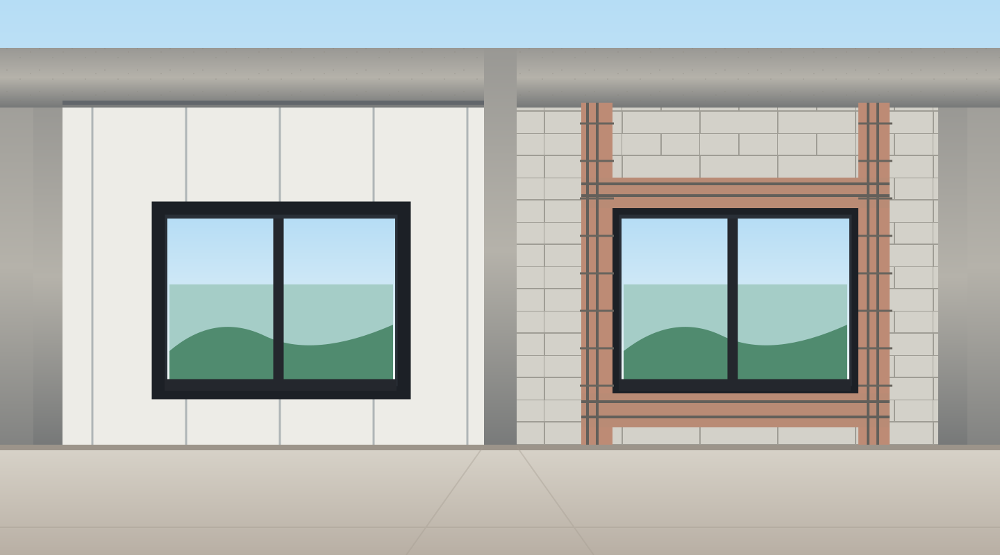
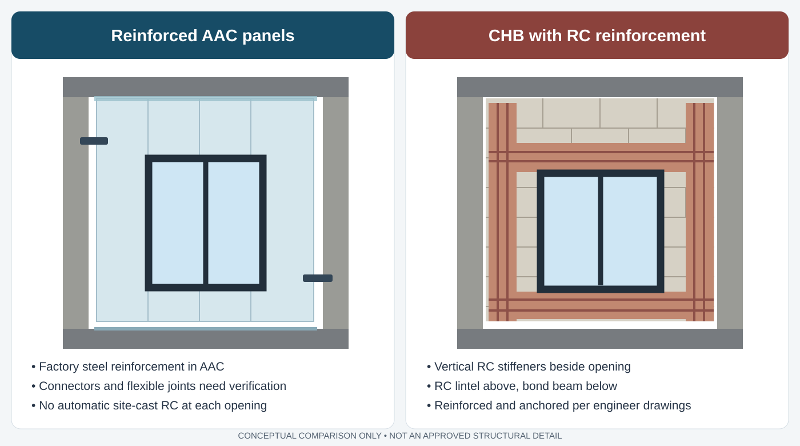

# AAC vs RC Around Windows: Do We Really Need All That Concrete?

When we decided to change the exterior walls of our house in Cebu from poured reinforced concrete to **reinforced AAC panels**, I expected some changes to the drawings. I did not expect the windows to become such a long discussion.

Our architect wants to use the reinforced AAC panel system proposed by **Dr. J** without automatically adding the usual concrete stiffener columns and beams around every opening. Our structural engineer has a different concern: he needs to see how the AAC panels, and especially their metal connections, resist the required loads.

Both positions make sense to me, but they are answering slightly different questions.

I previously explained [why I changed my mind about using reinforced AAC for our exterior walls](/why-i-changed-my-mind-about-aac-exterior-walls-in-cebu/). We are keeping the main reinforced concrete frame of the house. The AAC panels would replace the non-load-bearing wall infill, not the structural columns, beams or slabs.

The house is only around **200 metres from the sea**. I care about wind-driven rain, typhoons, corrosion, and earthquakes. I also care about avoiding unnecessary work and weight, which was one of the reasons to consider AAC in the first place.

## Why the drawings started a debate

The original structural drawings show the details of a traditional **concrete hollow block (CHB)** wall. Around the openings, there are reinforced concrete stiffener columns, lintel beams over windows, and bond beams below them.

For the larger openings, the lintel and the bond beam are designed to work with the stiffeners beside the opening. They need the proper reinforcement and anchorage shown in the engineer's details. It is not correct to assume that every lintel automatically runs all the way to the building's main RC columns.

Our Dr. J proposal uses **factory-reinforced AAC panels**. Its intention is to make the wall panels and their engineered supports do the work that would otherwise require much of this site-cast concrete.

Putting all the CHB details into the AAC wall would mean additional rebar, formwork, concrete pouring and curing. The architect questioned whether we would still get the construction benefits of choosing AAC.

His other point was very specific to our house: **we have relatively small wall segments and large windows**. With so little solid wall remaining around some openings, the additional stiffeners and beams can become a large part of the work.

*This is an explanatory illustration of the two approaches, not a shop drawing. The actual structural drawings use specific reinforcement sizes, laps and connections that must be checked separately.*

## What our structural engineer actually said

I asked the engineer whether Dr. J's window-opening detail failed a requirement of **NSCP 2015**, the reference code he used for his review.

His reply was more useful than a simple yes or no:

> I cannot conclude at this time that Dr. J's proposed AAC wall opening detail fails a specific provision of the NSCP 2015.

He explained that he has already calculated and checked the traditional CHB wall system. Its stiffener columns, bond beams, lintels and steel anchors give him a documented load path with adequate margin for his design assumptions.

He also said that **the AAC panels themselves appear to have sufficient capacity** based on the available information.

The problem is what happens at the edges.

Dr. J's submitted information does not yet demonstrate the load-carrying capacity of the **nails, screws, metal connectors and their anchorage into the main concrete structure**. Without that, the engineer cannot verify the complete AAC wall system.

This is a significant distinction. The engineer is **not saying that reinforced AAC cannot work**. He is saying that the CHB design has been checked, while part of the AAC design still needs supporting calculations.

I think that is a reasonable engineering objection. We cannot replace a checked system with an unchecked one just because the material manufacturer says it works.

## What happens during a typhoon or earthquake?

The clearest explanation came from the engineer when he described the different jobs of the frame and the wall.

The **main RC columns, beams and slabs** are designed to resist the building's primary earthquake loads. The CHB or AAC infill wall is not supposed to replace that frame.

The wall still has its own mass and experiences sideways forces during an earthquake. It also faces wind pressure and wind suction during a typhoon. Those forces must get from the wall into the RC frame.

In the reviewed CHB design, the reinforced stiffeners, beams and their anchored bars provide that path. With AAC, the factory-reinforced panel resists the load, and the **metal fasteners and connectors must transfer it to the frame**.

A strong panel with weak connections is not a complete system.

The engineer also raised another issue: the wall must allow the RC frame to move. If we trap an infill wall too tightly between columns and beams, it may crack or impose unwanted forces on the structure during an earthquake.

He described Dr. J's movement detail as having **roughly 15–25 mm compressible gaps at the top and sides**. One of our W2 architectural options calls out a **10–15 mm joint**, so I want these drawings reconciled before installation. A joint dimension copied from one sketch is not automatically the approved movement allowance for every wall.

A movement gap also creates a design challenge. The connection has to resist forces **out of the wall's plane** while allowing the movement required by the structural design. We need actual manufacturer details showing how that is achieved.

The wall being lighter helps too. In my earlier [RC, CHB and AAC comparison](/why-i-changed-my-mind-about-aac-exterior-walls-in-cebu/), the preliminary material-weight estimates were around **360 kg/m² for 150 mm RC**, **185 kg/m² for a reinforced CHB wall**, and **120 kg/m² for 150 mm AAC**. Those were comparison assumptions, not certified installed system weights. Reducing infill mass is useful, but it does not remove the need to check its anchors or mean the whole house has the same percentage reduction in earthquake force.

## Why the shape of our windows matters

One set of drawings is for **W2, a bedroom window**. It shows alternatives within a **2,600 mm-wide wall bay** with a **1,500 mm-wide window**, and changes to the window height and the wall remaining above or below it.

There are also openings such as **W8 in the dirty kitchen** that need their own details. I do not want to apply one generic window detail everywhere just because the material is the same.

Our architect suggested another possibility: **change the window dimensions to reduce or remove the small wall area above the opening**. In one version the window could become taller, closer to the beam above. That might avoid some conventional lintel work.

We discussed going even further and using **floor-to-beam windows**, similar to full-height sliding doors. But this is likely to be more expensive, and larger glazing changes the wind-load, frame-fixing, waterproofing and window-cost questions. It is not a free structural shortcut.

For now, I would rather compare three real alternatives:

| Option | Main benefit | What still needs checking |
| --- | --- | --- |
| Dr. J reinforced AAC window detail | Keeps the wall system light and avoids much of the additional cast-in-place concrete | Panel layout, connectors, anchor capacity, movement and window fixing |
| Traditional CHB with RC stiffeners and beams | The engineer has already documented and checked this specific CHB load path | Added weight, cost, formwork and whether it makes sense after changing to AAC |
| Adjusted or taller windows | May reduce the amount of wall and some opening details | Glass and frame cost, wind resistance, water tightness, support and architectural effect |

**Adding a CHB-style RC detail to AAC is not automatically unsafe or forbidden.** It may be needed for particular openings, if the engineered AAC panel system cannot satisfy the demands. My objection is to adding it everywhere without first showing why.

## The details I want from Dr. J

We have already received panel information, but the engineer needs enough evidence to close the complete structural review. I want one coordinated package that shows:

1. **The exact panel arrangement around each window**, including cut edges, reinforcement continuity, panel orientation and permitted spans.
2. **Connector and fastener capacity**, including the number, spacing, edge distances, design loads and anchorage into the supporting RC.
3. **Wind pressure and suction checks** for our actual openings and wall locations, rather than only the panel material's bending capacity.
4. **Seismic movement details**, including the correct compressible-gap dimensions and how the connections accommodate frame drift.
5. **Window frame anchoring**, especially under typhoon suction. Fixing a window into AAC is a separate question from fixing the AAC to concrete.
6. **External waterproofing and corrosion protection**, including flashing, joint sealants, coatings and protection of any exposed or embedded metal.

There is an ownership question too. We are planning to buy the panels directly from Dr. J and use a specialist installer, rather than leaving the original wall work entirely with the main contractor. The architect has already raised the need for clear responsibility for the wall finishes, windows, electrical and plumbing penetrations, leaks and final quality. I want the window/AAC/RC interface assigned to somebody, not left between contractors.

## The standards help, but do not approve our house

The [ACI PRC-526-19 guide](https://www.concrete.org/store/productdetail.aspx?Format=DOWNLOAD&ItemID=52619&Language=English&Units=US_Units) deals with the design and construction of factory-reinforced AAC panels. [ASTM C1694-09(2025)](https://store.astm.org/c1694-09r25.html) covers reinforced AAC elements, including reinforcement requirements, dimensional tolerances and drying shrinkage. [ASTM C1686-09(2025)](https://store.astm.org/c1686-09r25.html) covers installation and testing, including transverse load behaviour.

Those are useful technical references. They do not replace the **NSCP-based, project-specific review by our Philippine structural engineer**, nor do they establish that Dr. J's particular screws and connectors have enough capacity.

## Where we are now

My preference is still to use **Dr. J's reinforced AAC opening method as the starting point**. The architect's argument about avoiding a lot of extra concrete is practical, especially with our window sizes. I do not see much value in buying an engineered lightweight panel system and then automatically rebuilding the CHB reinforcement system around it.

But the engineer's question about the connection capacity has to be answered.

At this point, **neither of the two opening approaches has been shown to be the correct approved AAC detail for W2 and W8**. The traditional CHB scheme is the one the engineer says he has calculated and verified. That does not prove the AAC scheme fails, and it also does not prove we can omit additional RC in every location.

Next I want Dr. J to provide the missing connection calculations and coordinate the window details directly with our structural engineer and architect. Only then can we decide whether any openings genuinely need extra concrete, whether the windows should change, and what we can actually build.

*This is a record of a design discussion on our own construction project, not a structural detail to copy into another building. The final drawings and connections need approval from the responsible engineers.*
