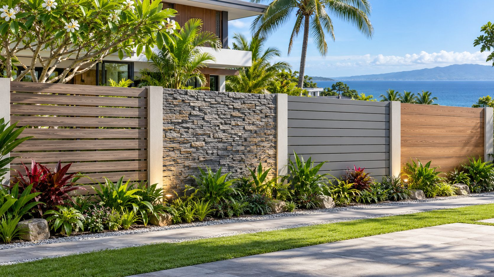
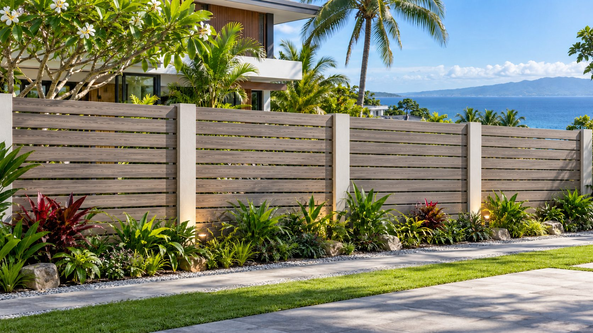
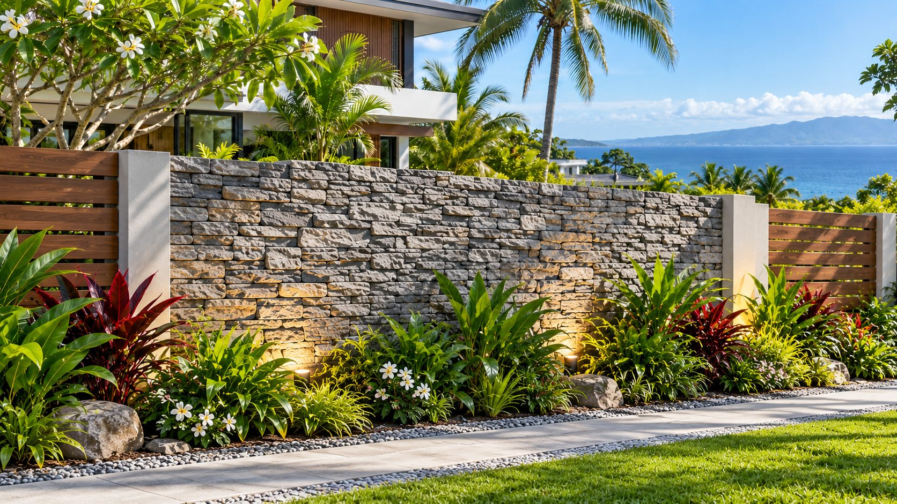
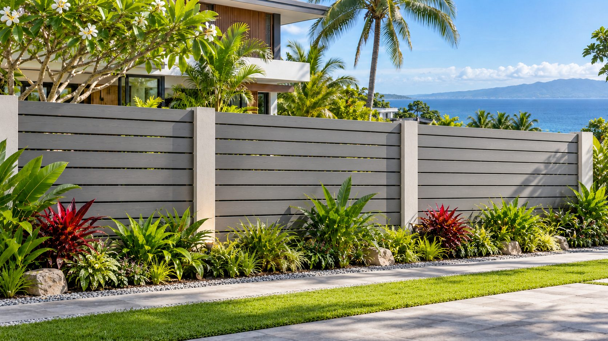
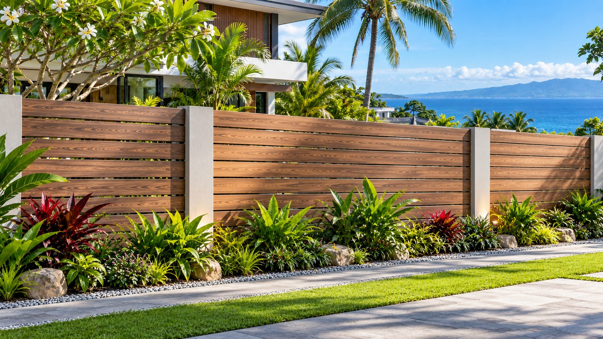

I started looking into bamboo for a decorative garden fence because I like the tropical look. A row of bamboo poles can make a concrete boundary feel a lot less like a compound wall.

Then I started thinking about the details. Cut bamboo can hold rainwater, untreated bamboo attracts borers, and our house in Cebu is roughly **200 metres from the sea**. There is humidity, wind-driven rain and salt in the air. I also don't want a nice-looking fence that becomes a place for rats or snakes to hide.

So I ended up comparing bamboo with several alternatives: wood-look aluminium, natural stone, WPC, fibre-cement planks, real timber and a living fence.

The goal is still the same. **I want something natural-looking, preferably grey and charcoal, without creating new maintenance and pest problems.** I am not trying to design a structural boundary fence from scratch. This is about decorative finishes and screening attached to a properly designed fence or frame.

I haven't ordered or installed any of these finishes yet. The pictures in this article are generated design illustrations for comparing appearances, not photographs of products I installed or manufacturer-approved construction details.

## First, do these materials actually attract mosquitoes or snakes?

This question changed how I looked at the options.

Mosquitoes don't breed in aluminium or wood grain. They breed around **standing water**. A hollow bamboo end, an open metal post, a flowerpot saucer or a blocked drainage channel can all collect it. The [CDC recommends emptying and scrubbing water-holding items once a week](https://www.cdc.gov/mosquitoes/mosquito-control/mosquito-control-at-home.html). That is a much more useful rule than searching for a fence material advertised as 'mosquito-proof'.

I found similar problems with the snake question. There is no good evidence that a certain fence colour or cladding material automatically attracts snakes. What matters much more is **shelter and food**. A pile of stones, overgrown plants, stored boards and a rodent population can give snakes a reason to visit. [Mississippi State University Extension explains those habitat factors](https://extension.msstate.edu/publications/reducing-snake-problems-around-homes), and [a Philippine herpetologist interviewed by GMA](https://www.gmanetwork.com/news/scitech/science/845733/why-do-snakes-sometimes-wander-into-houses-kuya-kim-explains/story/) makes the same connection between dark sheltered spaces and rodents.

I don't expect to make an entire garden free of insects, lizards or wildlife. That is not realistic in the Philippines. But I can avoid creating unnecessary water traps, hidden cavities and food sources.

Termites are a different issue. They can attack untreated bamboo and timber, while aluminium, stone and fibre cement are not food for them. But using those materials does not automatically protect the rest of a fence if the concealed frame is ordinary wood.

## The options I would actually consider

| Finish | Why I like it | What worries me |
| --- | --- | --- |
| Wood-look aluminium | Natural appearance without actual timber; replaceable slats | Coastal coating quality, connections, cost and wind loading |
| Natural stacked stone | Real texture; works with the house design | Heavy, expensive over large areas, difficult crevices to inspect |
| Exterior WPC | Wood-like finish without ordinary timber upkeep | Product quality, UV, thermal expansion and hidden fixings |
| Fibre-cement wood planks | Local supply, termite-resistant material, can be painted grey | Supporting frame, joints, paint and impact damage |
| Treated bamboo | Best genuine tropical character | Borers, decay, wet cut ends and ongoing maintenance |
| Real timber | Beautiful, repairable, lots of design flexibility | Termites, moisture, coating work and species verification |
| Living hedge | Actually green, softer appearance | Trimming, damp sheltered areas, possible rodents, slow privacy |

These are material and design trade-offs, not measured rankings for mosquitoes, snakes or service life.

## 1. Wood-look aluminium: probably my first choice

Aluminium slats with a timber-pattern finish make sense for the look I want. They don't provide food for termites or wood borers, the sections can be replaced, and there are no hollow bamboo ends pointing up at the sky.

For our house I would choose a **grey wood-grain or charcoal finish**, not the orange-brown timber colour that appears in a lot of catalogues.

But I wouldn't buy the cheapest 'powder-coated aluminium' just because that is what the listing says. The coating preparation matters. [QUALICOAT's guidance for coastal architectural aluminium](https://qualicoatuki.org/news/specifying-maintaining-architectural-powder-coatings) specifically discusses pretreatment, marine exposure and additional cleaning. A nice surface in a showroom doesn't tell me how it will look after repeated salt and rain exposure.

The other details are the posts, brackets and screws. A stainless screw against an aluminium member can introduce galvanic-corrosion issues in a wet salty environment. [The British Stainless Steel Association](https://bssa.org.uk/bssa_articles/11-technical-library-bimetallic-galvanic-corrosion-risks/) explains why metal combinations and moisture matter. I would ask for the complete fixing specification, including any isolation washers.

And the slats still need proper structural support. An almost-solid privacy screen catches wind even if it is lightweight. I want our engineer to check the posts, concrete anchorage, spacing and exposure before treating it as a typhoon-ready design.

**Cost:** I haven't found a reliable comparable Cebu quotation for a complete wood-look aluminium fence. Prices for individual online profiles are not installed rates. I would request the exact alloy, finish, coating warranty, dimensions, supporting frame and installed price per linear metre.

## 2. Natural stacked stone: I like this, but not everywhere

The house already has a modern grey and charcoal direction, with natural-looking stone accents. The same material could make the fence feel connected to the house rather than being a completely separate design.

What I would *not* do is clad 20 metres of boundary wall in stone without first working out the weight and fixing cost.

Stone veneer needs a sound substrate and installation system. If rain gets behind it, the water has to be managed, not trapped. And if the stone is loosely stacked with deep open pockets, those spaces can shelter small animals. I would prefer tightly detailed cladding on selected concrete columns or feature panels, keeping the ground below open enough to inspect.

I found a real published Philippine price example: [Wilcon's P.Tech natural stone cladding, model X-209](https://shop.wilcon.com.ph/natural-stone-cladding-304900000028.html), is listed at **₱2,720 per box**, with **eight 15 × 60 cm pieces**. If all pieces have the nominal rectangular face area, that is **0.72 m² per box**, or around **₱3,778/m² in stone pieces alone** at the listed promotional price.

That calculation excludes wastage, adhesive, substrate preparation, waterproofing, labour, delivery and any structural work. It also assumes the advertised dimensions represent usable face coverage, which I would confirm before ordering.

For a simple illustration, a fully clad **20 m × 1.8 m** face would be **36 m²**, requiring **50 boxes before any waste** at that theoretical coverage. The listed stone alone would be **₱136,000**. This is arithmetic from one advertised product, *not* a project quotation or a recommendation to buy exactly that quantity.

This example makes me more interested in **stone accents** than a fully stone-clad fence.

## 3. Exterior WPC: interesting if I can verify the actual product

WPC is tempting because it can give a natural texture without looking like metal.

But WPC covers a wide range of products, from basic boards to better capped systems. I wouldn't use interior fluted wall panels outside just because the shop calls them WPC.

[NewTechWood Philippines](https://www.newtechwood.ph/product/fencing/) sells a capped composite fencing system under its UltraShield range. The company advertises UV, stain and mildew resistance and a **25-year warranty**. That is a manufacturer's product claim; I still need to examine the written warranty, exclusions, installation method and relevance to exposed coastal conditions.

There is also an easy-to-check price example: [CONST.PH lists a Techwood WPC fence board for ₱685](https://const.ph/product/techwood-wpc-fence-board/), with listed dimensions **21 × 160 × 1,783 mm**. That is a *board price*, not the installed cost of one metre of fence. I would need to know the actual exposed cover width, direction, gaps, frame spacing and number of boards before doing a proper quantity estimate.

WPC doesn't rust like steel. That doesn't mean the **screws, steel frame or anchors** won't rust. I would also check thermal-expansion allowances and whether cut edges expose the composite core.

For a decorative screen in a sheltered area, this may be perfectly reasonable. For fully exposed windward sections of our house, I would want samples and detailed manufacturer installation drawings first.

## 4. Fibre-cement wood planks: a practical local option

This one surprised me a little. I first associated fibre cement with boards for ceilings and wall partitions, not something I would deliberately show in a garden.

But [Central Lumber sells Gardner TPI wood-grain fibre-cement planks](https://clc.com.ph/clc-product/wood-planks/) for fences, gates and exterior cladding. Its listed unpainted planks are **150 or 200 mm wide, 3,000 mm long and 8 mm thick**, with wood-grain textures. The manufacturer also provides an installation layout and fixing guidance. They even show completed fences in Cebu and Talisay.

There is a [pre-painted Premium Plank version](https://clc.com.ph/clc-product/premium-wood-plank/), although I would still want to see how the available colours look in our actual daylight.

The advantage is clear: termites won't eat the cement board itself, and I can choose a grey paint finish that matches the house. Unlike natural timber, I don't have to preserve organic planks.

The trade-off is the supporting frame and the finishes. It is a cladding product, not a structural wall by itself. The manufacturer's fence guidance for the premium version gives a **maximum 0.4 m frame spacing** for its specified steel-framed assembly. I would follow the exact instructions for the product selected rather than assume any light steel channel is adequate.

I don't have a verified current Cebu retail price for these specific fence planks, so I am not inventing one. This is definitely one of the options I would ask Central Lumber to quote.

## 5. Bamboo: I still like it, with reservations

Bamboo has the most authentic tropical appearance of all these options. It also creates the most questions for a fully exposed fence.

The concern is not that bamboo somehow emits a mosquito attractant. Open vertical culms can **collect standing water**. Some bamboo species and untreated products are also vulnerable to borers, termites and fungal deterioration. Sealing a surface with ordinary varnish doesn't solve all of those problems.

For real Philippine pricing, [Kawayan Collective publishes treated kawayan tinik and bagacay starting at ₱90 per metre](https://sites.google.com/view/kawayancollective/products), and giant bamboo from **₱210 per metre**. The listed diameters are different, so those prices are not interchangeable or directly comparable per square metre of fence.

There is also local research on the bamboo supply chain. Habitat for Humanity's [2025 overview of the bamboo industry in Cebu and Negros Oriental](https://www.habitat.org/sites/default/files/documents/An%20Overview%20of%20the%20Bamboo%20Industry%20in%20Cebu%20and%20Negros%20Oriental%20-%20June%202025.pdf) is worth reading before assuming all locally sold bamboo has the same quality or treatment.

For this project I would want documented preservation suitable for the exposure, ends that cannot hold water, a raised dry base and replaceable sections. Borate-only treatment is not something I would automatically trust in repeated direct rain, because borates are water-soluble. I also wouldn't promise a fixed lifespan without knowing the species, treatment and exposure.

Maybe for a covered lanai or a small garden feature. I'm less convinced about using it for the full coastal boundary.

## 6. What about real wood and living plants?

Real timber can look better than wood-look aluminium. I understand the appeal.

But I would need to choose a known species, confirm legal sourcing, find out how it was dried and treated, and accept a regular coating and inspection routine. I wouldn't assume all tropical hardwoods are naturally termite-proof, and I wouldn't compare a cheap untreated board with an engineered aluminium system as if both need the same maintenance.

A hedge is a different kind of answer. It can hide an ugly boundary fence and make the whole garden feel more natural. For the Camotes farm, where we already have GI posts and barbed wire, I still like the idea of a **separate planted line inside the structural fence** rather than trapping trunks and branches in the wire.

The trouble is access. Dense low plants growing into the fence can hide rat activity, damaged foundations and stagnant water. They also make it difficult to see a snake before getting close to it.

I'd keep a clear maintenance strip and use a few selected plants rather than a solid wall of wet foliage. I would avoid water-retaining decorative planters with saucers, and I wouldn't trust claims that planting citronella alone will keep mosquitoes away.

## Rust is mostly a connection problem

For our coastal house, the screws and brackets deserve almost as much attention as the main cladding.

Even stainless steel is not automatically corrosion-proof. The [British Stainless Steel Association's seawater guidance](https://bssa.org.uk/bssa_articles/selection-of-316-304-and-303-types-of-stainless-steels-for-seawater-applications/) describes the limits of 316, including pitting and crevice corrosion, while warning against treating 304 as equivalent in seawater service.

That doesn't mean every bolt in a fence 200 metres from the sea must automatically be 316. Actual salt deposition, wetting, detail geometry, cleaning and the engineer's specification matter. But it does mean I would not accept 'stainless' with no stated grade or ordinary zinc-plated screws hidden behind expensive exterior cladding.

For aluminium, I'd ask about coating pretreatment and a coastal-grade finish. For steel supports, I would ask what protective system covers cut edges, welds and fixing holes. And I would avoid details that permanently hold salty water between joined components.

A sample panel can help me judge appearance, but it cannot replace a proper wind and corrosion specification.

## Snakes, rats, frogs and geckos: what I can actually control

I don't want to exaggerate the snake problem, but I also don't want to ignore it.

Stone gaps, piles of unused construction materials and very thick groundcover can provide shelter. Food scraps, unsecured animal feed or rubbish can attract rats, and rats can attract snakes. A perfectly smooth wall doesn't solve that if I leave a pile of boards beside it.

This is why I like a narrow, tidy planted area with visible gravel and a way to inspect the base of the fence. I'd rather notice a rat hole or an opening early than discover it underneath a dense hedge months later.

Geckos and frogs are part of the local environment. I wouldn't try to eliminate them from the garden. My actual concerns are preventing breeding water, limiting rodent access and not making accidental encounters with snakes more likely.

If I do see a snake, I would keep my distance and contact trained local rescuers rather than try to grab or kill it. That is also consistent with [DENR-7 officials' advice reported in Cebu](https://cebudailynews.inquirer.net/557597/what-actions-should-you-do-when-encountering-snakes).

And I would be skeptical of commercial snake repellent granules or plants claimed to make a property snake-proof. Habitat management and safe exclusion make more sense.

## The real cost comparison is still missing one big piece

The published prices I could verify on **24 October 2026** are useful, but they are not directly comparable:

| Material or product | Published Philippine price | What the price actually buys |
| --- | ---: | --- |
| Kawayan Collective treated kawayan tinik | From **₱90/m** | One linear metre of treated culm, diameter-dependent |
| Kawayan Collective treated giant bamboo | From **₱210/m** | One linear metre of larger bamboo |
| CONST.PH Techwood WPC fence board | **₱685/board** | One 21 × 160 × 1,783 mm board |
| Wilcon P.Tech X-209 stone cladding | **₱2,720/box** | Eight 15 × 60 cm stone pieces |
| Gardner fibre-cement wood planks | **Quote required** | Specific plank and finish to be confirmed |
| Wood-look aluminium fence system | **Quote required** | Complete slats, posts, finish and installation to be specified |

The first four are retailer/supplier listings, not quotes delivered to my site. Stock, promotional prices, delivery to Cebu or Camotes and taxes where applicable must be checked when ordering.

I don't want to turn those numbers into one fake '₱ per metre installed' table. A 1.8-metre-high privacy fence might require new foundations and posts, or it might simply be decorative infill fixed between existing properly designed concrete columns. Those are completely different jobs.

The contractor quote needs to separate the supports, finish boards or veneer, fixings, waterproofing or coatings, labour, wastage and delivery. For stone, I'd also want substrate preparation and drainage details. For a windy coastal site, the post and anchorage design could be a significant part of the job.

## What I would build, at least for now

For the main house, I am leaning toward a **combination**: grey stacked stone on selected concrete columns or feature panels, with **charcoal or grey wood-grain aluminium slats** between them. A few tidy tropical plants in front would soften the look.

WPC or grey-painted fibre cement could make sense where the quotation is better or a section is more sheltered. I would still keep bamboo as a possible decorative accent, but not as the default material for every metre of exposed fence.

For Camotes, the decision is different. We already have a lightweight GI-post and wire boundary. I wouldn't attach heavy stone panels or a solid privacy screen to those posts without redesigning the supports for wind. A separate living hedge or small lightweight screens would be more realistic there.

Before deciding, I want installed quotations for the same height and length, coating and fastening specifications, and small material samples that I can leave outside through rain and sun.

There is one detail I want to check on every sample and on the final installation: **after a heavy rain, where does the water go, and can I still see and clean the bottom of the fence?** If I cannot answer that, I am not ready to install it.
