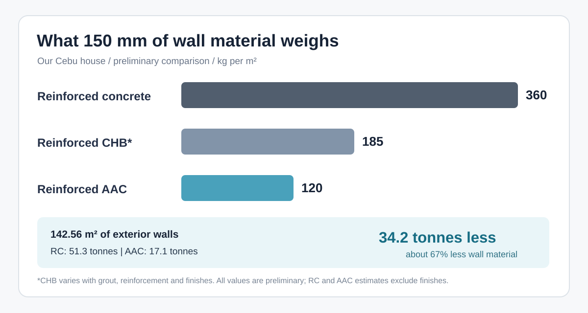
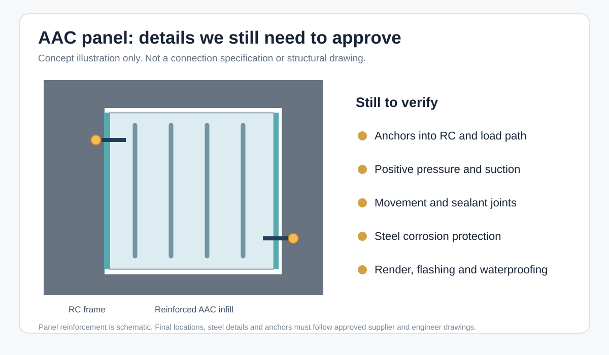

# Why I Changed My Mind About AAC Exterior Walls in Cebu

A couple of years ago I wrote [an article about AAC blocks](/aac-blocks-better-than-hollow-blocks/). At the time, I liked AAC for interior partitions, but I was not convinced about putting it on the outside of a house near the sea.

I was worried about moisture. AAC is porous, and our house in Cebu is only around **200 metres from the sea**. With wind-driven rain, salty air and typhoons, concrete felt like the safer choice.

Our exterior walls were originally planned in **poured reinforced concrete (RC)**, supported by the main concrete frame. I also compared traditional concrete hollow blocks (CHB) and later [Werkhof's alternative block system](/werkhof-blocks-vs-700-psi-and-regular-hollow-blocks-in-cebu/).

Now I am seriously considering AAC for the exterior too.

The reason I changed my mind is that I am no longer comparing ordinary AAC blocks with a concrete wall. We are looking at a specific **factory-made, steel-reinforced AAC panel system**, with a supplier calculation, an installation method and actual quotations. That gives us something more useful to evaluate.

It does not mean my original moisture concern was wrong. I still need the wall to stay dry, the reinforcement to remain protected, and the connections to survive typhoon winds. I just no longer think that AAC should be rejected automatically because it is porous.

## First, the wall weight caught my attention

The current Dr. J exterior AAC quotation covers **142.56 m²** of wall. The proposed panels are **600 × 150 × 2,800 mm**, installed vertically between the concrete structural members. The 2,800 mm length is important: the wall section we discussed with our architect is around **2.8 metres high**, not a continuous 10-metre-high AAC wall.

I compared three wall options at approximately 150 mm thickness:

| Wall option | Preliminary weight per m² | For 142.56 m² |
| --- | ---: | ---: |
| Poured reinforced concrete (RC) | ~360 kg | ~51.3 tonnes |
| Traditional reinforced CHB wall | ~185 kg | ~26.4 tonnes |
| Steel-reinforced AAC panel | ~120 kg | ~17.1 tonnes |

The RC calculation assumes concrete at approximately **2,400 kg/m³**: 0.15 × 2,400 = **360 kg/m²**.

For AAC, I used the **preliminary design density of 800 kg/m³**: 0.15 × 800 = **120 kg/m²**. That is an estimate for the panel material, not a supplier-certified installed wall weight.

The CHB figure of 185 kg/m² is a rough wall-system estimate. It changes with the block type, reinforcement, grout filling, mortar and finishing. I would not use it for final structural calculations without defining the actual CHB assembly.

For the same quoted area, switching from 150 mm RC to 150 mm AAC changes the preliminary wall-material weight from **51,321.6 kg to 17,107.2 kg**.

That is **34,214.4 kg less**, or approximately **34.2 tonnes and 67%**. Before wall finishes and other installation materials.

This is the number that made me reconsider.

But there is an important limit: **it is a 67% reduction in the compared wall material, not in the weight of the entire house**. Foundations, beams, columns, slabs and the roof are still there. Nor does 67% less wall weight mean 67% less earthquake force on the complete building.

## Why this matters for earthquakes

During an earthquake, the building moves and its mass creates inertia forces. Reducing the mass of non-load-bearing walls can reduce part of that seismic demand.

The main structure of our house will remain reinforced concrete. AAC would be used as **non-load-bearing infill and partition panels**, not as a replacement for columns, beams or structural slabs.

Lighter infill looks attractive, but I also have to think about what happens when the concrete frame moves sideways during an earthquake. A rigidly trapped wall can crack. A badly connected panel can become dangerous even if it is light.

So the actual design needs proper allowances for frame movement, joints and anchors. Panel weight by itself does not prove earthquake safety.

For reinforced AAC specifically, the [American Concrete Institute's ACI PRC-526-19 guide](https://www.concrete.org/store/productdetail.aspx?Format=DOWNLOAD&ItemID=52619&Language=English&Units=US_Units) covers the design and construction of factory-reinforced panels. It is a useful technical reference, not a substitute for our Philippine engineer approving the exact installation.

## The typhoon question is more complicated

Our engineer prepared a preliminary wind-pressure calculation of **2.34 kPa**, using a **250 km/h wind speed** as an input. The Dr. J supplier's structural calculation evaluated the proposed panels under **5 kPa** loading.

Initially those numbers look encouraging. The supplier's assumed panel pressure is higher than the preliminary design pressure.

But I would be making a mistake if I simply said: "5 is higher than 2.34, so we are safe."

A supplier calculation is not a site test, and pressure assumptions are only one part of the design. We need to compare like with like: positive pressure, **negative pressure or wind suction**, loading combinations, actual panel support conditions and fixing details. The local demand may also change around corners, openings and wall edges.

Even if the AAC panel itself resists the calculated bending load, the **anchors connecting it to the RC frame** still have to transfer that load safely.

The supplier's preliminary reinforcement detail identifies **four 6 mm steel wires**. We are still checking their arrangement, the protective treatment of that steel, the panel design assumptions and how everything connects to the concrete.

This drawing is only an illustration of the issues to inspect, not the approved Dr. J installation detail.

The [ASTM C1686 practice for reinforced AAC installation and testing](https://store.astm.org/c1686-09r25.html) is another useful reference because it specifically addresses transverse loading and installation. For our project, the approved drawings and site-specific structural calculations have to take priority.

## Insulation was another reason to reconsider AAC

Our house is in a hot, humid climate and we will be using air conditioning. Concrete is strong, but a solid concrete wall is not a very good thermal insulator.

AAC has a much lower thermal conductivity than ordinary dense concrete. The [Australian Building Codes Board's published material properties](https://www.abcb.gov.au/editions/ncc-2022/adopted/volume-one/j-energy-efficiency/36-material-properties) list example values of **0.27 W/(m·K)** for 900 kg/m³ AAC and **1.44 W/(m·K)** for solid concrete. These are reference material values, not measured performance of the particular Dr. J panels we are buying.

The exact benefit in our house depends on the supplied panel density and thermal test data, the external render, glass, columns, roof insulation and air leaks. I cannot honestly turn that into a percentage saving on electricity without doing a proper building-envelope calculation.

Still, less heat coming through the wall is something I value. Especially when I can get it while reducing wall weight.

There is also a construction advantage. Prefabricated panels may simplify installation and reduce traditional formwork for the wall areas being replaced. But electrical chasing and drilling need care: **I cannot let workers cut through embedded steel reinforcement just because AAC is easy to cut**.

## My old concern about water has not disappeared

This is where I remain cautious.

Our house is close to the sea, and the exterior wall will face rain driven by strong winds. If water gets through a joint, around a window, or behind the finish, a lighter panel will not magically prevent damage.

What I want to see is the complete external wall specification: compatible basecoat or render, waterproofing and coatings, movement-joint sealing, proper flashing, details below and around windows, and a practical repair method.

The reinforcement is also important. The steel inside a reinforced AAC panel must be protected as required by the system specification. I want documentation of the factory corrosion protection, especially because our site has coastal exposure.

And there are fixings. Air-conditioner supports, cabinets, heavy shelves, window frames and other attachments should not rely on random masonry plugs. They need approved anchors or connections to the RC frame, according to their loads.

I still expect some cracks at interfaces between materials over time. The question is whether those joints are properly designed and remain weather-tight, and how easy they are to inspect and repair.

## Changing the wall material also affects the contractor

There is another practical problem that has nothing to do with density.

Our original contract included the RC wall works. We have discussed removing the affected wall construction from that scope, **buying the AAC panels directly from Dr. J**, and using a separate specialist installer.

That sounds simple until we get to windows, doors, electrical work, plumbing, plaster, paint and waterproofing. All those trades depend on the walls.

If rain leaks around a window after installation, who has to fix it? The window installer, AAC installer, finishing contractor, or the main contractor? I do not want to discover the answer after a typhoon.

Before installation, the responsibilities need to be documented: who sets out the openings, who accepts the RC frame tolerances, who supervises the AAC installer, who applies the finishes, and who is responsible for the completed wall interfaces and defects.

Changing from poured RC to AAC may also remove some formwork and concrete work from the original quotation. I want those deductions and the full AAC installed cost agreed properly, not just a comparison of panel purchase prices.

## Where I stand now

At the moment I am leaning toward **150 mm steel-reinforced AAC panels for the non-load-bearing exterior walls** and **100 mm AAC panels for interior partitions**, while keeping the main RC structure.

I am not calling the exterior decision final yet. We still need our structural engineer to sign off on panel reinforcement, wind pressure and suction, anchorage, movement joints and the full connection detail. We also need an agreed coastal waterproofing system and clear responsibilities between the installers and the main contractor.

I was much more skeptical of AAC exterior walls when I wrote the [original AAC article](/aac-blocks-better-than-hollow-blocks/) in 2024. With the actual panel dimensions, weight calculations and supplier engineering documents in front of me, I think it deserves a proper evaluation instead of an automatic rejection.

If the technical details check out and the installed price is reasonable, AAC could make more sense for this house than the RC walls we originally planned.

I will update this after the drawings are approved and the panels are actually installed. That will be a much better test than comparing brochures.
